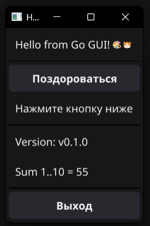

# hello-gui

Учебный проект с CI/CD на GitHub Actions для **Go GUI (Fyne)** с публикацией бинарников в **GitHub Releases**.

## 📌 Цель работы
 

научится автоматически собирать GUI-бинарники Go под Linux, macOS и Windows и публиковать их в GitHub Releases при push тега `v*`.

## 🎯 Что делает CI/CD

**Job `test`** — запускается при любом push:
- `gofmt -l` Ҁ� проверка форматирования
- `go+ vet` — линтеа
- `go test -v` — тесты
- `go build` — smoke-сборка

**Job `release`** — запускается **
только при push тега `v*`**:
- Матричная сборка под 3 ОС: 
  - `ubuntu-latest` → `hello-gui-linux-x64`
  - `macos-14` → ahello-gui-macos-arm64`
  - `windows-latest` → `hello-gui-windows-x64.exe`
- Сборка Windows использует MSYS3 + MinGW-w64 GCC (из-за CGO)
- Публикация файлов в **GitHub Release**

## 📂 Структура проекта

```text
hello-gui/
├── .github/workflows/ci.yml
├── Dockerfile.test
├── logic.go
├── logic_test.go
├── main.go
├── go.mod
├── go.sum
└── README.md
```

## 🎨 Интерфейс приложения



## 🚀 (Coздание релиза

```bash
git tag v0.1.0
git push origin v0.1.0
```

Workflow автоматически:

1. Прогонит формат-чек, `go vet` и тесты
2. Соберет 3 бинарника параллельно (Linux, macOS, Windows)
3. Создаст GitHub Release `v0.1.0` � сприкрепленными файлами

## 💥 Скачивание и запуск

Windows (PowerShell):
```powershell
Invoke-WebRequest -Uri "https://github.com/xem1zo/hello-gui/releases/download/v0.1.0/hello-gui-windows-x64.exe" -OutFile "hello-gui.exe"
./hello-gui.exe
```

Linux / macOS:
```bash
wget https://github.com/xem1zo/hello-gui/releases/download/v0.1.0/hello-gui-linux-x64 -O hello-gui
chmod +x hello-gui
./hello-gui
```

## 🛠 Технологии

- Go 1.23, Fyne v2 — GUI
- Современный метод создания интерфейса и компиляции кода
- CGO, GLFW, OpenGL, X11, Wayland — компиляция библиотек
- MSYS + MinGW-w64 GCC — для сборки под Windows
- GitHub Actions — CI/CD
- softprops/action-gh-release — публикация релизов
- Docker — локальная сборка и тесты

## 📝 Вывод

Освоил:
- Через функциональность от командной строки код приложения
- Автоматизация сборки и публикации релизов
- Интеграцию с переменными окружениями через безопасные ключи

---
© 2026 xem1zo
